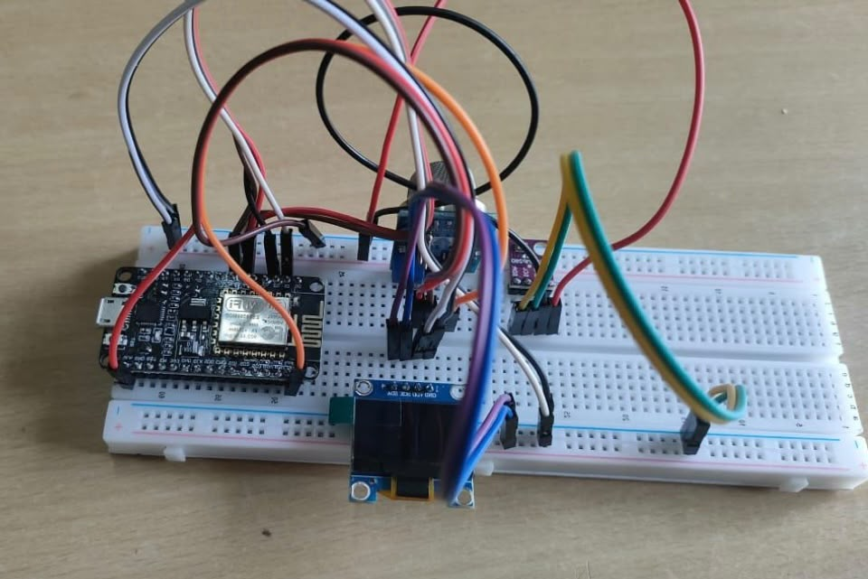

# Child Safety Monitoring System Using IoT

An IoT-based environmental monitoring system designed to improve child safety by identifying potentially unsafe conditions inside enclosed spaces and vehicles.

## Project Overview

The Child Safety Monitoring System is a group academic project developed to address the risks associated with children being left unattended inside enclosed spaces or vehicles.

The system uses environmental sensors and a microcontroller to monitor important parameters such as carbon monoxide, oxygen levels, temperature and humidity. By collecting and processing sensor readings, the system is designed to identify potentially hazardous environmental conditions and generate alerts when predefined thresholds are exceeded.

The project combines embedded systems, sensor technology and IoT concepts to demonstrate a practical approach to environmental safety monitoring.

## Hardware Prototype

The following image shows the physical prototype developed by our team.



## Key Features

- Continuous environmental parameter monitoring.
- Gas detection using an MQ-series sensor.
- Temperature and humidity monitoring.
- Oxygen-level monitoring as part of the project design.
- Microcontroller-based sensor data collection.
- Wireless communication for remote monitoring.
- Threshold-based warning and alert mechanism.

## Technologies and Components

| Category | Technology |
|---|---|
| Programming Languages | Python, Arduino C++ |
| Microcontroller | ESP-based development board |
| Gas Sensor | MQ-series gas sensor |
| Temperature and Humidity Sensor | DHT11 |
| Display | OLED Display |
| Communication | Wi-Fi |
| Development Platform | Arduino IDE |

## System Architecture

The system is organized into five main layers:

1. **Sensor Layer:** Collects environmental readings such as gas levels, temperature and humidity.
2. **Processing Layer:** The microcontroller receives and processes the sensor data.
3. **Communication Layer:** Supports wireless transmission of collected information.
4. **Monitoring Layer:** Evaluates environmental readings to identify potentially unsafe conditions.
5. **Alert Layer:** Provides warning messages when configured thresholds are exceeded.

## System Workflow

1. Environmental sensors collect readings from the surrounding environment.
2. The microcontroller receives the sensor data.
3. Sensor readings are processed and evaluated.
4. Environmental conditions are monitored against configured thresholds.
5. Potentially unsafe readings trigger warning messages.
6. Wireless communication supports remote monitoring as part of the project design.

## Firmware Implementation

The repository includes an Arduino-based firmware implementation for sensor monitoring.

The current firmware demonstrates:

- Gas sensor data acquisition.
- Temperature and humidity monitoring using DHT11.
- Serial Monitor output for sensor readings.
- Threshold-based warning messages.
- Conditional configuration for ESP8266 and ESP32 development boards.

The firmware provides the foundation for further development of the IoT monitoring system.

## Repository Structure

```text
Child-Safety-Monitoring-System-Using-IoT/
│
├── firmware/
│   └── main.ino
│
├── README.md
│
└── child-safety-prototype.jpeg
```

## My Contribution

As a team member, my contributions included:

- Understanding project requirements and the overall system workflow.
- Participating in project research and documentation.
- Exploring IoT sensors and their role in environmental monitoring.
- Contributing to the overall development work alongside the team.

## Future Enhancements

- GPS-based location tracking.
- Enhanced wireless data monitoring.
- Cloud-based data storage and visualization.
- Mobile application notifications.
- Integration of additional environmental sensors.

## Authors

This project was developed as a group academic project by:

1. Alphin Das
2. Arjun S
3. Akshay S
4. Sayandhana KS

**Department:** Artificial Intelligence and Data Science

**Institution:** Adi Shankara Institute of Engineering and Technology, Kalady, Kerala, India.

## Acknowledgment

We sincerely thank the faculty of Adi Shankara Institute of Engineering and Technology for their guidance and support throughout this project.
